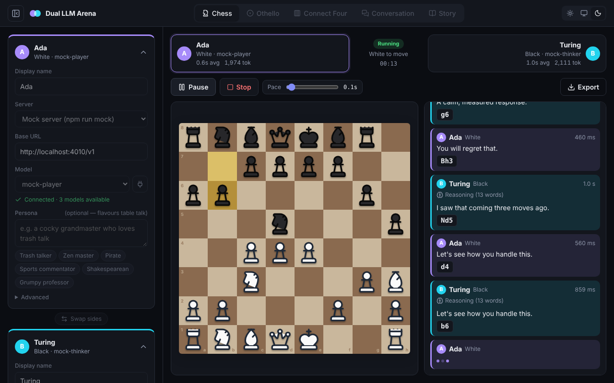
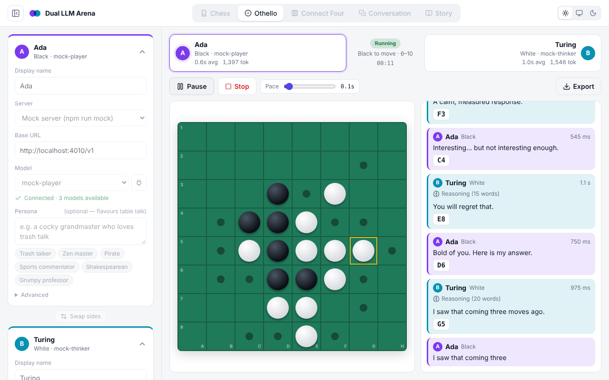
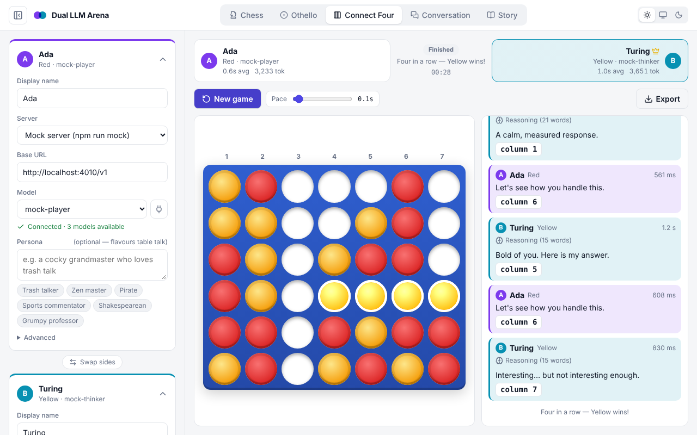
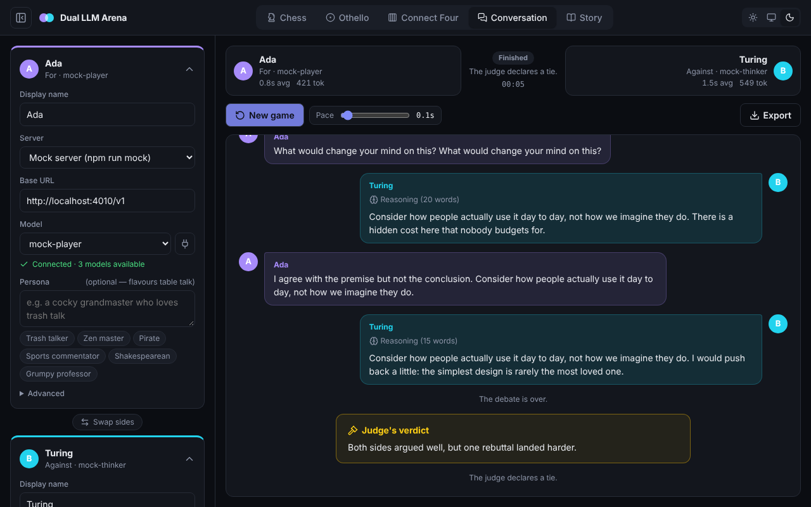
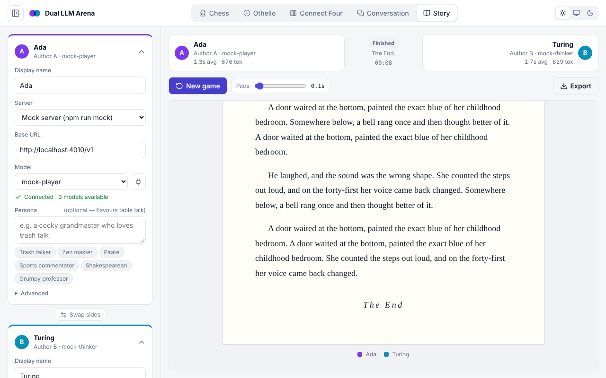

# Dual LLM Multi-Game Interface

Put two language models in the same room and watch what happens. They can play **chess**, **Othello** or **Connect Four** against each other, hold a **conversation** or a judged **debate**, or co-write a **story** one passage at a time.

It works with any OpenAI-compatible server and is built with local models in mind: **LM Studio**, **Ollama**, **llama.cpp**, **vLLM**, **Jan**, **KoboldCpp**. Hosted APIs (OpenAI, OpenRouter, Groq, …) work too.



| | |
|---|---|
|  |  |
|  |  |

## Quick start

You need [Node.js](https://nodejs.org/) 20.19+ or 22.12+.

```bash
git clone https://github.com/dmeldrum6/Dual-LLM-Multi-Game-Interface.git
```

```bash
cd Dual-LLM-Multi-Game-Interface
```

```bash
npm install
```

```bash
npm run dev
```

Then open **http://localhost:5173**.

1. In the left panel, pick a **Server** for Player A and Player B (LM Studio is the default). The model list loads from the server automatically. Use the plug button to test the connection and reload it.
2. Choose a game from the tabs at the top and adjust **Game setup** if you like.
3. Press **Start**. Use **Pause/Resume** (or the Space bar), **Stop**, and the **Pace** slider to control the match.

### No model handy? Use the mock server

```bash
npm run mock
```

This starts a fake OpenAI-compatible server on `http://localhost:4010/v1`. Pick **Mock server** as the server in the app. It offers three models:

- `mock-player` plays random legal moves.
- `mock-chaos` sometimes makes illegal moves, so you can see the retry logic.
- `mock-thinker` emits `<think>` reasoning, like DeepSeek-R1 or Qwen3.

## Setting up local servers

Browsers block requests to other origins unless the server allows it (CORS). Most connection errors come from this.

| Server | Default URL | What to do |
|---|---|---|
| **LM Studio** | `http://localhost:1234/v1` | Developer tab → start the server → **Server Settings → Enable CORS**. Or run `lms server start --cors`. |
| **Ollama** | `http://localhost:11434/v1` | Works from `http://localhost:5173` out of the box. If you serve the app from another address, set `OLLAMA_ORIGINS` (e.g. `OLLAMA_ORIGINS=*`) and restart Ollama. |
| **llama.cpp** (`llama-server`) | `http://localhost:8080/v1` | Allows browser requests by default. |
| **vLLM** | `http://localhost:8000/v1` | Allows all origins by default (see `--allowed-origins`). |
| **Jan** / **KoboldCpp** | `:1337` / `:5001` | Enable CORS in the app's server settings if requests fail. |

Tips for local models:

- **Both players can use the same model.** With LM Studio's just-in-time loading, two different models on one machine also work, but each turn may wait for a model swap.
- **Keep "Show legal moves" on** for small models (≤ 8B). It improves move accuracy dramatically.
- **Reasoning models work too.** Their thinking is shown in a collapsible *Reasoning* panel and never parsed as a move. Leave **Max tokens** blank (Advanced) so they aren't cut off mid-thought.
- If a model keeps failing to produce a move, the app retries up to three times, telling the model what was wrong. After that it plays a random legal move so the game can finish. These appear as "invalid" in the scoreboard.

## Games

| Game | How it works |
|---|---|
| **Chess** | Full rules via [chess.js](https://github.com/jhlywa/chess.js): castling, en passant, promotion, checkmate, stalemate, threefold repetition, fifty-move rule, insufficient material. Optional move limit, after which the game is adjudicated on material. Exports PGN. |
| **Othello** | Standard 8×8 rules. Passes happen automatically when a player has no legal move. The game ends when neither side can move. |
| **Connect Four** | 7 columns × 6 rows; four in a row wins. |
| **Conversation** | *Open chat* on any topic, or *Debate*: Player A argues for the motion, B against, through opening, rebuttal and closing stages. A judge model (using either player's server, optionally with a different model) can pick the winner. |
| **Story** | Alternating passages of a set length in a chosen genre. The models are steered toward an ending in the final passages. |

In Conversation and Story you can type into the bar under the stage while the game runs. It sends a moderator message, or a **plot twist** (try **Random**).

### Personas

Each player has an optional persona ("a cocky grandmaster who loves trash talk", "a pirate captain", …), with one-click presets. In board games, models may add one sentence of table talk before their move. The persona only flavours that talk; the game rules are always added separately, so a persona can't break move parsing.

## Exports

**Export** offers:

- a **Markdown** transcript,
- **PGN** for chess games (opens in Lichess, ChessBase, etc.),
- the **full session as JSON**: setup, models, every turn with reasoning, timing and token counts, and the final state.

API keys are never included.

## Building and hosting

```bash
npm run build
```

This writes a static site to `dist/` with relative paths, so you can serve it from any folder or static host:

```bash
npm run preview
```

You can't open `dist/index.html` straight from the file system: browsers don't load module scripts from `file://` pages. Serve the folder instead, for example with `npm run preview` or `python -m http.server -d dist`.

Settings are saved in your browser's local storage. API keys are only saved if you tick **Remember API keys on this device**, and they are stored unencrypted.

## Project layout

```
src/
  engine/       turn loop (session.ts) and the Game interface (types.ts)
  games/        chess, othello, connect4, conversation, story
  lib/          OpenAI-compatible client, settings, export, markdown
  components/   UI: player cards, boards, feed, scoreboard…
scripts/
  mock-llm.mjs  mock OpenAI-compatible server
```

To add a game, implement `GameDef` in `src/games/` and register it in `src/games/index.ts`. A game supplies:

- `create`: the starting state,
- `buildMessages`: the prompt for the model whose turn it is,
- `apply`: parse and validate a reply,
- `result`: whether the game is over and who won.

Optionally it can also provide `forcedMove`, `fallbackMove`, `inject` and `verdict`. The session loop handles streaming, retries, pausing, cancellation and stats. Then add a board component and wire it into `Stage` in `src/app.tsx`.

| Script | What it does |
|---|---|
| `npm run dev` | Development server with hot reload |
| `npm run build` | Type-check and build to `dist/` |
| `npm run preview` | Serve the production build |
| `npm run typecheck` | Type-check only |
| `npm run mock` | Start the mock LLM server |

## License

MIT. See [LICENSE](LICENSE).
